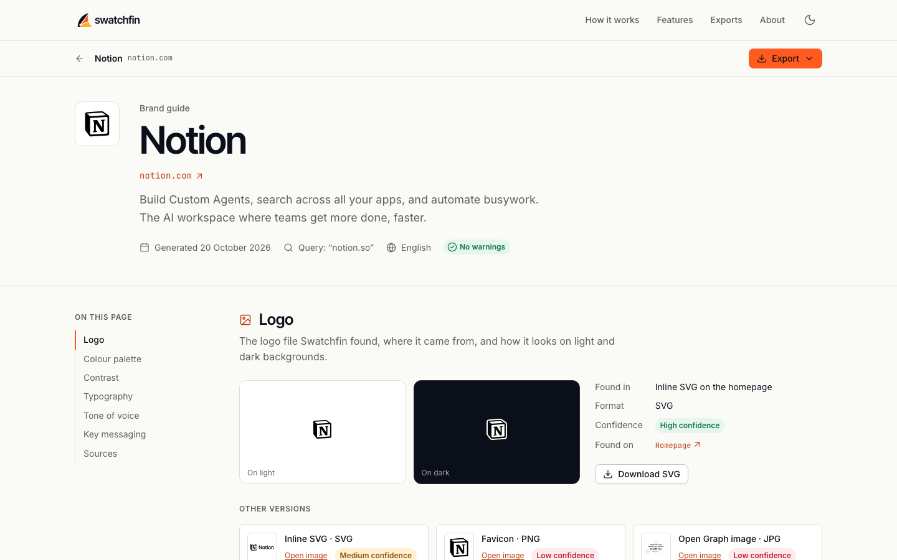
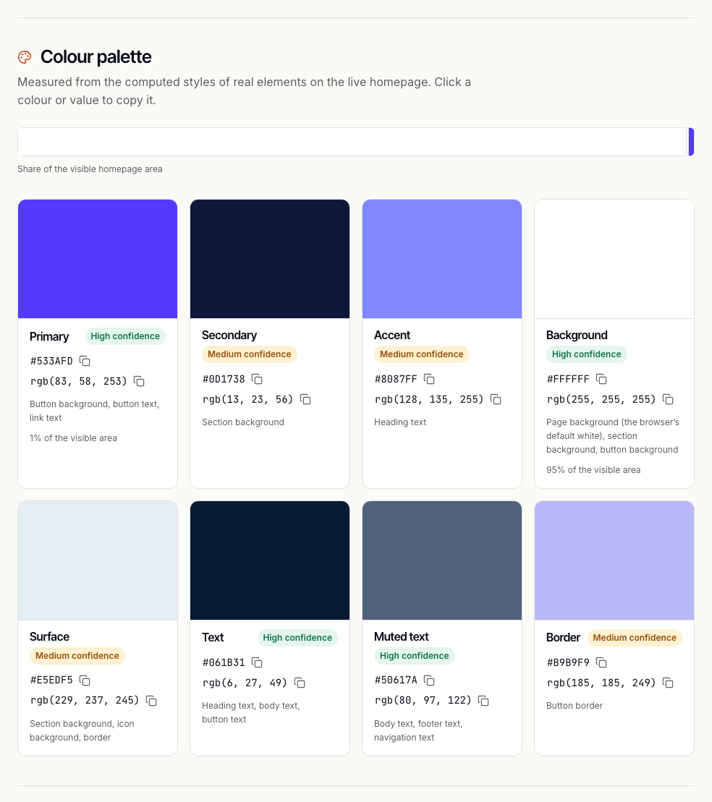
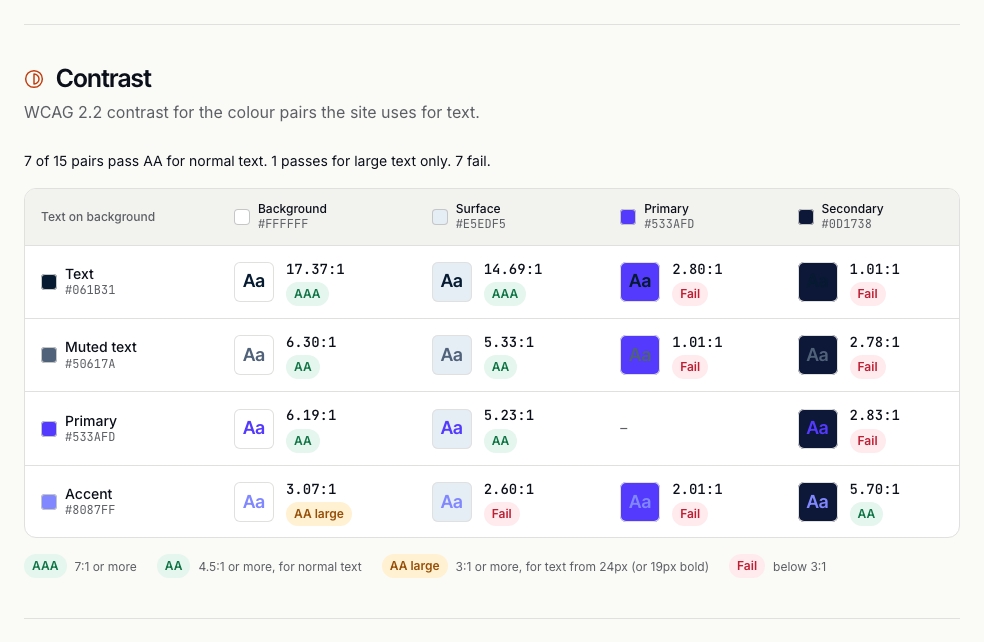
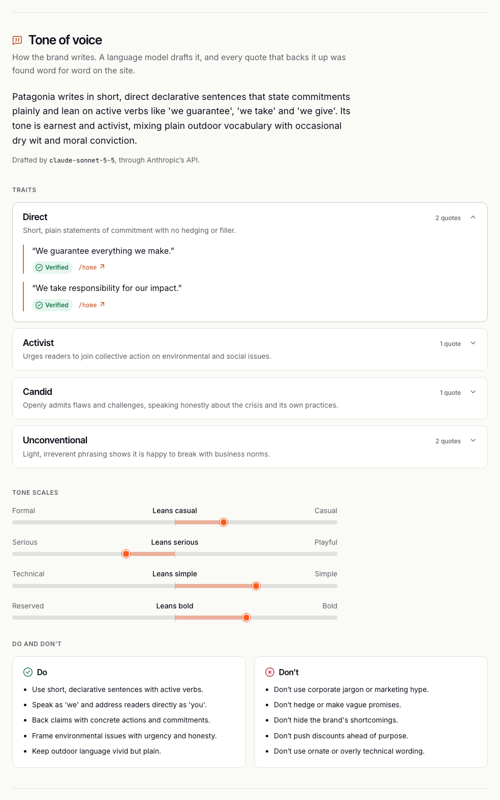
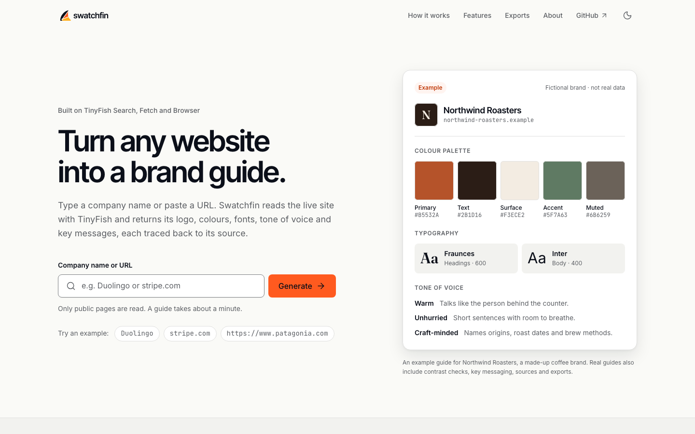
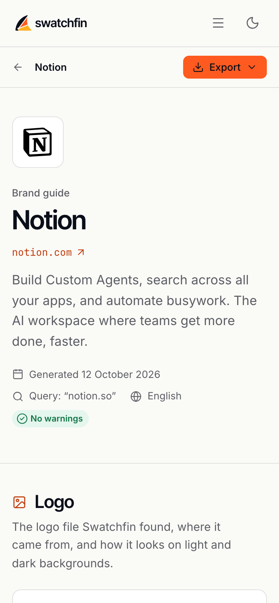

<p align="center">
  <picture>
    <source media="(prefers-color-scheme: dark)" srcset="frontend/assets/brand/swatchfin-logo-dark.svg">
    
  </picture>
</p>

<p align="center"><strong>Brand guides from any URL, powered by TinyFish.</strong></p>

<p align="center">
  Type a company name or paste a website URL. Swatchfin reads the live site and gives you a brand guide: logo, colour palette, typography, tone of voice and key messaging. Everything in it comes from the site and is checked against it.
</p>

<p align="center">
  <a href="https://swatchfin.onrender.com"><strong>Try it live: swatchfin.onrender.com</strong></a>
  <br>
  <sub>It runs on a free server. If nobody has visited for 15 minutes, the first page takes about a minute to wake up.</sub>
</p>

<p align="center"><sub>I built Swatchfin for the TinyFish Student Bounty Drop 001, "Brand Guide Generator".</sub></p>

<p align="center">
  
</p>

---

## Features

Swatchfin finds a brand's website, reads the homepage and up to nine more pages with TinyFish, and opens the homepage in a real browser to measure it. Each guide has:

- **Name or URL in, brand guide out.** Give it `duolingo` or `https://www.duolingo.com` and it finds the official site by itself.
- **Logo**, with a download link. Swatchfin looks in the page header and anywhere the homepage labels a picture with the brand's name. That can be an image, inline SVG code, or a CSS background like Amazon's sprite, which the browser photographs as a PNG. If none of those works, it uses the Open Graph image or the tab icon.
  - A logo drawn with SVG code is copied in the colours the browser really drew it in.
  - Every version is drawn once more, and left out if it comes out blank or as a plain shape.
  - Interface icons (checkmarks, arrows), promotions ("Free Delivery") and other companies' logos are never taken as the logo.
  - Tab icons are copied to Swatchfin as PNGs, because some sites (like x.com) don't let other sites show their files. If no logo image can be shown at all, the guide shows the brand's first letter in a plain tile and says so.
- **Colour palette with roles**: primary, secondary, accent, background, text, link and more. The colours come from the computed styles of real page elements, not from a screenshot.
- **Contrast checks**: a WCAG contrast table for the palette, with AA and AAA badges.
- **Typography**: heading, body and UI fonts, with weights, sizes and live specimens.
- **Tone of voice**: traits, four tone scales and do and don't lists. Every claim comes with an exact quote from the site.
- **Key messaging**: tagline, mission, value propositions and audience, each linked to the page it came from.
- **Sources**: every page that was read, and which TinyFish API read it.
- **No made-up data.** Every quote is checked against the text that was read. If something can't be found, the guide leaves it empty and adds a warning.
- **Exports for other tools**: JSON, CSS custom properties, a Tailwind CSS v4 theme, W3C Design Tokens and a ready-to-paste "write in this brand's voice" prompt. The guide page also prints cleanly to PDF.

## Screenshots

These are real guides, made from the live sites on 12 October 2026. There are more in [`docs/screenshots/`](docs/screenshots/), and `tools/screenshots.py` takes them again.

| Stripe: colour palette, each colour with a role and where the site uses it | Stripe: WCAG contrast for the pairs the site uses for text |
|---|---|
|  |  |

| Patagonia: tone of voice, every trait backed by a quote found word for word | The start page, and a guide on a phone |
|---|---|
|  | <br><br> |

## How TinyFish is used

Swatchfin uses three TinyFish APIs, and each one has its own job:

| TinyFish API | What it does in Swatchfin |
|---|---|
| **Search** | Turns a company name into its official domain. It also finds the brand's own pages that the homepage doesn't link to, like brand guidelines, press kits, and the About or careers pages of sites built with JavaScript. |
| **Fetch** | Reads the live homepage twice at the same time. One read gets its `<head>`, header, navigation, footer and logo word for word (for the logo, icons, meta tags and links). The other gets its main text as markdown. Then Fetch reads up to 9 more pages as markdown (About, Mission, Careers, Press, Blog, Product) for the tone of voice and messaging. |
| **Browser** | Opens the homepage in a real browser (one short session per guide, always closed) and reads the **computed** colours and fonts of real elements: buttons, headings, body text, links and navigation. It confirms the logo, copies SVG logos in the colours they are really drawn in, and draws each copy in a blank tab to check it shows a logo. It also reads what Fetch can't: the homepage and up to 3 pages of sites built with JavaScript. It costs about a tenth of a cent of wallet credit per guide. |

```
name or URL → Search (resolve) → Fetch (homepage) → Search + links (choose pages) → Fetch (pages)
            → Browser (computed styles) → voice analysis → quote verification → BrandGuide JSON + page + exports
```

The details, what the docs and live tests showed, and results on three very different sites are in [docs/how-tinyfish-is-used.md](docs/how-tinyfish-is-used.md).

## Tech stack

| Layer | Tools |
|---|---|
| Frontend | Semantic HTML, a CSS custom-property design system, Bootstrap 5.3 grid and reboot (heavily customised), vanilla JavaScript (ES modules), Lucide icons, self-hosted Inter, Inter Tight and JetBrains Mono |
| Backend | Python 3.11+, FastAPI, Uvicorn, Pydantic v2 |
| Web data | TinyFish Search, Fetch and Browser; Playwright over CDP; selectolax |
| Voice analysis | Anthropic Claude API, with Google Gemini and Groq as fallbacks, behind one wrapper |
| Quality | pytest, ruff |

The backend also serves the frontend as static files, so the whole app deploys as one service.

## Getting started

### Set up (once per computer)

You need **Python 3.11 or newer** (check with `python3 --version`) and a **TinyFish API key** from [agent.tinyfish.ai](https://agent.tinyfish.ai/api-keys). For the tone of voice and key messaging you also need at least one language model key: **Anthropic** ([console.anthropic.com](https://console.anthropic.com)), **Google Gemini** ([aistudio.google.com](https://aistudio.google.com/apikey), free tier) or **Groq** ([console.groq.com](https://console.groq.com/keys), free tier). If you have more than one, Swatchfin asks them in turn (see [Tone of voice](#tone-of-voice-how-its-checked-and-what-it-costs)).

Without a TinyFish key the app still runs, but every guide stops with a message that it can't read websites. Without any language model key, guides have everything else, and a warning says the tone of voice is missing.

```bash
git clone https://github.com/ankanhq/swatchfin.git
cd swatchfin
python3 -m venv .venv                          # a private folder of Python packages for this project (git-ignored)
source .venv/bin/activate                      # turn it on: your prompt now starts with (.venv)
python -m pip install --upgrade pip
pip install -r backend/requirements-dev.txt    # the pinned packages, plus pytest and ruff
cp .env.example .env                           # your settings and keys (git-ignored, never commit it)
```

Then open `.env` and put your keys after `TINYFISH_API_KEY=`, `ANTHROPIC_API_KEY=`, `GEMINI_API_KEY=` and `GROQ_API_KEY=` (leave out any you don't have). `ANTHROPIC_MODEL`, `GEMINI_MODEL` and `GROQ_MODEL` pick the models (by default `claude-sonnet-5-5`, `gemini-3.8-flash` and `openai/gpt-oss-120b`), and `LLM_ORDER` sets the order they are asked in (by default `anthropic,gemini,groq`).

On Windows, turn the virtual environment on with `.venv\Scripts\activate` instead.

### Run Swatchfin

In every new terminal, turn the virtual environment on first, then start the server from the repo root:

```bash
source .venv/bin/activate
python tools/serve.py
```

Open [http://localhost:8000](http://localhost:8000). The interactive API docs are at [localhost:8000/api/docs](http://localhost:8000/api/docs). Press Ctrl+C to stop. To use another port, add it at the end: `python tools/serve.py 8001`.

This runs the FastAPI app in `backend/app`, the same app that runs on the live site. It serves the API under `/api/v1` and the website from `frontend/`. It restarts by itself when you save a Python file in `backend/app`. For HTML, CSS and JavaScript changes, just reload the page.

Every file is sent with `Cache-Control: no-cache`, so the browser checks for a new version on every load and never mixes an old cached module with a new one. Text files are gzip-compressed. A missing address gets Swatchfin's own 404 page with a real 404 status (try [localhost:8000/anything](http://localhost:8000/anything)), and a missing `/api/...` address gets a JSON answer. If a page ever looks out of date, do a hard refresh (Cmd+Shift+R or Ctrl+Shift+R).

### Run the tests

```bash
pytest backend           # all backend tests, against a fake TinyFish (no network, no key needed)
pytest backend -m live   # the tests that call the real TinyFish, Anthropic, Gemini and Groq APIs (each skipped without its key; 1 search, 1 page, under $0.01)
ruff check backend       # code checks
ruff format backend      # formats the Python code
```

### The API

A guide takes 30 to 90 seconds, so it is made as a background job. Start one, then ask for its progress until it is `complete` or `failed`:

| Method | Path | What it does |
|---|---|---|
| `POST` | `/api/v1/guides` | Body `{ "query": "duolingo" }`. Answers `202 { "id", "status" }` straight away |
| `GET` | `/api/v1/guides/{id}` | The job's status and its seven steps, and the full brand guide once it is complete |
| `DELETE` | `/api/v1/guides/{id}` | Cancels a job that is still queued or running (`204`). A finished guide answers `409` |
| `GET` | `/api/v1/guides/{id}/export?format=json` | Downloads the guide as `json`, `css`, `tailwind`, `tokens` or `voice` (see [Exports](#exports)). A format the guide has nothing for answers `409` |
| `GET` | `/api/v1/guides/{id}/logos/{n}.svg` or `.png` | Swatchfin's copy of a logo the site draws in its page: a cleaned SVG (only shapes, colours and text), or a PNG photo of a logo drawn with CSS. Served so that it can't load or run anything |
| `GET` | `/api/v1/health` | `{ "status": "ok" }` |

Every error has the same shape, written for people: `{ "error": { "title": "Guide not found", "message": "There is no guide with this ID…" } }`. The full guide format, the job status and the limits are in [docs/api.md](docs/api.md). The code that defines them is `backend/app/schemas.py`, and a running copy shows them at `/api/docs`.

**Limits.** On the live site, each visitor (IP address) can start 15 new guides in any 24 hours (`VISITOR_DAILY_LIMIT`) and make 300 API requests a minute. Everyone together can start 90 new guides a day, UTC (`DAILY_GUIDE_LIMIT`), which keeps Swatchfin inside TinyFish Fetch's free 1,000 pages a day. A local copy allows 5 and 50 unless you change these settings. If a site already has a complete guide from the last 24 hours, you get that guide straight away, and it doesn't count toward either limit. At most two guides are made at once, and the others wait their turn. Finished guides are saved in `backend/data/guides/` and their copied logos in `backend/data/logos/` (both git-ignored) for 30 days. You can change all of these in `.env` (see `.env.example`).

**Security.** Every answer carries security headers (`backend/app/headers.py`):

- Browsers may not guess file types, show Swatchfin inside another site's frame, or use the camera, microphone or location.
- Links to other sites share only Swatchfin's address, not the guide's, and after one visit browsers always use https.
- A Content-Security-Policy lets the pages run only Swatchfin's own script files, so text from a brand's website can never run as code. The only other places the pages load from are Google Fonts (for a brand's font in the typography specimen) and the brand's own https images.
- API answers may load nothing at all, and logos and exports are sandboxed. The API docs may load only Swagger UI from jsdelivr and their one inline script, which is named by its SHA-256 hash.
- A test fails if a page ever gets an inline script, an inline style or an `onclick`-style handler.

### How a guide is made

Steps 1 to 5 read the live site with TinyFish: finding the site (for a name), reading the homepage, choosing pages and reading them, and then measuring the homepage's colours, fonts and logo in a real browser. Step 6 sends the text TinyFish read to a language model (Claude first, then Gemini, then Groq if the one before can't answer). The model drafts the tone of voice and key messages, with an exact quote for each claim, and the guide names the model that wrote them. Step 7 looks for every quote, word for word, in that same text. It drops what isn't there, says so in a warning, and grades the palette's text and background pairs for WCAG contrast. Nothing is made up to fill a gap.

Each guide opens one TinyFish Browser session, which costs about $0.001 of wallet credit (set `USE_BROWSER=false` in `.env` to leave it out while developing). It usually makes one Claude call, which costs about $0.02 to $0.03 (see below).

These addresses show every state of the guide page:

| Address | What it shows |
|---|---|
| [`guide.html?q=Patagonia`](http://localhost:8000/guide.html?q=Patagonia) | A real guide from a company name (uses your TinyFish key) |
| [`guide.html?q=stripe.com`](http://localhost:8000/guide.html?q=stripe.com) | The same from a URL (the search step is skipped) |
| [`guide.html?q=nothing-here.invalid`](http://localhost:8000/guide.html?q=nothing-here.invalid) | A guide that stops at "Reading the homepage", because `.invalid` addresses never exist |
| [`guide.html?id=mock`](http://localhost:8000/guide.html?id=mock) | With `SAMPLE_GUIDES=true` only: the full sample guide for *Northwind Roasters*, a fictional brand, labelled as mock data (`frontend/mock/MOCK_northwind-roasters.json`) |
| [`guide.html?id=mock-partial`](http://localhost:8000/guide.html?id=mock-partial) | With `SAMPLE_GUIDES=true` only: a partial sample guide whose browser step "timed out", so colours and fonts are missing |
| [`guide.html`](http://localhost:8000/guide.html) | The empty state ("No guide to show") |
| [`guide.html?id=nope`](http://localhost:8000/guide.html?id=nope) | The "Guide not found" error |

Click **Cancel** while a guide is being made to go back to the start page with your search still in the box. The job stops on the server too.

The sample guides follow the exact guide and job status shapes in [docs/api.md](docs/api.md) (the tests check this), and every part of them is labelled as mock. They are only for building the guide page, Lighthouse runs and tests, so the server serves them only when `SAMPLE_GUIDES=true` is in `.env`. That is off by default and in production. In production no guide marked MOCK is ever served, not even one left in the guides folder, and real guides never use them.

The other pages: [`about.html`](http://localhost:8000/about.html) explains how Swatchfin uses TinyFish Search, Fetch and Browser (with a pipeline diagram, limitations and a privacy note), and any missing address shows the 404 page ([localhost:8000/anything](http://localhost:8000/anything)).

**Print or save as PDF.** On a guide, choose Export → *Print or save as PDF*, or press Cmd/Ctrl+P. The printout is always light, keeps the brand colours exact, starts with the brand header and warnings, and puts each section on its own page, with page numbers in Chrome and Edge.

### Tone of voice: how it's checked, and what it costs

A language model reads up to 36,000 characters of the brand's own pages. The homepage comes first, then the brand, About and mission pages, with menus, footers and repeated lines taken out. Its answer must follow a fixed shape, with a quote and a page address for every trait, tagline, mission and value proposition.

Careers, jobs and culture pages describe how staff work, so the model is told not to use them as evidence for traits, value propositions or the audience. A mission stated there still counts.

`backend/app/extract/verify.py` then looks for each quote in the text TinyFish read. Only spacing, quote marks and a final full stop may differ. A quote that isn't there is dropped with a warning, and so is a trait left without a quote.

A page that turns out to be a robot check ("Click the button below to continue shopping", "Are you a robot?", "Verifying you are human") is never read as the brand's words. It is left out of the text and of the checks, and the guide says "This site limited automated access, so the tone of voice is based on little text." When every page was a robot check, there is no tone of voice, and the warning says why.

**Three models, asked in turn** (`backend/app/llm.py`). Swatchfin asks Claude (`claude-sonnet-5-5`) first. If it gives no usable answer for any reason (an API error, too slow, a rate limit, no credit left, a refusal, an answer in the wrong shape), the same instructions and text go to Google Gemini (`gemini-3.8-flash`), then to Groq (`openai/gpt-oss-120b`).

- Each model but the last gets at most 30 seconds, and all of them together get 75 seconds of a guide's 150.
- If none of them answers, the guide still finishes without a tone of voice, and one warning gives each model's reason.
- Every answer gets the same word-for-word check, and the guide page says which model wrote it ("Drafted by `gemini-3.8-flash`, through Google's Gemini API.").
- `LLM_ORDER` in `.env` changes the order or leaves a model out, and a model without a key is left out anyway.
- The server log says which model answered, what it cost and why any model before it didn't. The guide itself doesn't include costs.

Groq no longer serves Llama 3.3 70B. It was shut down on 16 August 2026 for free and developer accounts ([Groq deprecations](https://console.groq.com/docs/deprecations); the API answers `model_not_found`). Swatchfin uses Groq's recommended replacement, `openai/gpt-oss-120b`, which supports strict structured outputs (`GROQ_MODEL` changes it). Groq's free tier allows 8,000 tokens a minute and refuses a longer text outright (HTTP 413). So for a site near the 36,000-character limit, Groq can't help when Claude and Gemini both fail. Gemini is called through its Interactions API with `store: false`, so Google doesn't keep the request as a conversation.

**Why this order.** On 12 October 2026, the same text from stripe.com, patagonia.com and duolingo.com went to all three models, twice each (`tools/benchmark_voice.py`):

- **Claude** answered every time, and all 68 of its quotes were found on the pages. It took about 8.5 s and cost $0.023 to $0.032 a guide.
- **Gemini** was just as accurate when it answered (49 of 49 quotes) and costs nothing on the free tier, but it was too busy to answer 2 of its 6 calls. It says so within 2 to 4 seconds, so trying it costs little time.
- **Groq** always answered and was the fastest (3 to 4 s), but 20 of its 78 quotes weren't on the pages word for word. Step 7 dropped them, so its guides stay accurate but thinner.

So Claude goes first, Gemini second and Groq last. The full table, and what each model got wrong, are in [docs/testing.md](docs/testing.md#tone-of-voice-benchmark).

### Tested on 13 live sites

On 12 October 2026 Swatchfin made guides for 13 sites. Each one was checked by hand against the live page (logo, button colours, fonts, tagline, quotes and warnings), then checked again after the fixes. These are the final guides:

| Site | Primary (and other brand colours) | Fonts | Tagline |
|---|---|---|---|
| notion.so | `#0075DE` blue buttons, `#F64932` | NotionInter | “The AI workspace that works for you.” |
| airbnb.com | `#DA1249` search button | Airbnb Cereal VF | “Get an Airbnb for every kind of trip” |
| spotify.com (its web player) | `#1ED760` play button | SpotifyMixUI, SpotifyMixUITitle | none found |
| zomato.com | `#FFC6CD`, `#DFCFFF`, `#FFEEAF` (colour blocks; no colourful buttons) | Our Lexend | “Better food for more people” |
| nike.com | `#111111` black buttons | Nike Futura ND, Helvetica Now Text | “Nike. Just Do It” |
| mailchimp.com | `#FFE01B` yellow | Means Web, Graphik Web | none found |
| linear.app | `#E5E5E6` light buttons on near-black | Inter Variable, Berkeley Mono | “The system for product development” |
| figma.com | `#000000` black buttons, `#00B6FF` and `#24CB71` from the logo | figmaSans | “Figma: The collaborative canvas for design, code, and AI” |
| lego.com | `#F47D20` “Add to Bag”, `#FFD502` yellow header | Cera Pro | none (its headings are promotions) |
| tata.com | `#E2A330` gold buttons, `#0876B9` | Lato | “Leadership with Trust.” |
| ikea.com/de (German) | `#0058A3` blue, `#FFDB00` yellow | Noto IKEA | none found |
| champaca.in (an independent bookshop) | `#A3AB3B` olive buttons | Yrsa, PT Sans | none found |
| patagonia.com | `#000000` black buttons, `#1B2B79` navy hero | Ridgeway Sans | “MADE FOR THE MOMENT. BUILT FOR A LIFETIME.” |

Every logo was the brand's own, and 134 of 136 quotes were found word for word (the other two were dropped, with a warning). The bugs found and fixed along the way, and the later checks on notion.so, amazon.in and flipkart.com after the deploy, are in [docs/testing.md](docs/testing.md#tested-on-13-live-sites).

Still true, and listed on the About page:

- A colour the homepage shows only in a heading, or not at all, isn't listed. Patagonia's orange `#FA4616` is in one campaign heading today, and Zomato's red isn't on its homepage.
- A web-app homepage like Spotify's changes between visits.
- A short name can match the wrong site: “Tata” finds tata.cars, so type “Tata group” or the address.

The 34 test guides cost $0.96 with Claude (about $0.03 a guide) and $0.046 of TinyFish wallet credit. Search and Fetch cost nothing.

### Exports

Export on a guide page (or `GET /api/v1/guides/{id}/export?format=…`) downloads the guide in five formats. `backend/app/export/` has one module for each:

| Format | File | What's in it |
|---|---|---|
| `json` | `stripe-brand-guide.json` | The whole guide, in the versioned format described in [docs/api.md](docs/api.md) |
| `css` | `stripe-brand.css` | `--brand-color-<role>`, `--brand-font-<role>` and `--brand-logo` custom properties in `:root`, each with a note on where the site uses it |
| `tailwind` | `stripe-tailwind.css` | A Tailwind CSS v4 `@theme`: classes such as `bg-brand-primary`, `text-brand-text-muted` and `font-heading` |
| `tokens` | `stripe-brand.tokens.json` | [W3C Design Tokens, format 2025.10](https://www.designtokens.org/TR/2025.10/format/): sRGB colours, and a family, weights and sizes for each font role. Usage and confidence go under `$extensions` |
| `voice` | `stripe-voice-prompt.md` | A Markdown prompt: the voice in brief, traits with their quotes and pages, the four tone scales, do and don't, key messages |

Rules every export follows:

- **It says where it came from.** Each file starts with `Made by Swatchfin from the live site https://stripe.com/ on 10 October 2026.` (the guide's date). Sample guides say `MOCK sample data for a fictional brand, not a live site` instead. The JSON export is the one exception. It is exactly the guide's format, which already has `generated_at`, `brand.url` and `sources`.
- **Only what was found.** A missing font means no font line, not a guessed one. The voice prompt has only quotes found word for word on the site, and leaves out any trait without one. The tokens file has no combined typography token, because the format needs line heights that Swatchfin doesn't measure. A guide with no colours or fonts can't be exported as CSS, Tailwind or tokens (the menu greys them out and says why), and a guide with no tone of voice has no voice prompt.
- **Website text stays text.** Every value is put on one line, and hidden direction-changing characters are removed. Font names become escaped CSS strings, so they can't add rules or end a `<style>` element, and comments can't be closed early. In the tokens file, font names with `{…}` are left out, because tools read those as links to other tokens. In the voice prompt, Markdown characters are escaped, so a quote can't turn into a link, an image, HTML or a heading. The prompt also says the quotes are examples of style, not instructions. The tests try all of this with a hostile guide (`backend/tests/export_guides.py`).
- **Copied logos travel inside the file.** A logo Swatchfin copied (an SVG drawn in the page, or the photo of a CSS background) lives on Swatchfin's server, which forgets it when it restarts. So when the copy is under 100 KB, the CSS and tokens files hold the logo itself, as a `data:image/svg+xml;base64,…` or `data:image/png;base64,…` address. If the copy is bigger or gone, the file uses the brand's next logo file on its own site instead (never its social preview image). If there is none, the file has no logo instead of a broken one. A logo that is already a file on the brand's site keeps its address. The JSON export is exactly the guide, with Swatchfin's full address for a copy.

To use the Tailwind theme, import it after Tailwind in your main CSS file:

```css
@import "tailwindcss";
@import "./stripe-tailwind.css";
```

Checked with real tools on 11 October 2026: Tailwind CSS 4.1.13 builds the classes from the Tailwind file, and Terrazzo 2.7.1 (`tz check`) finds no errors in the tokens file for Stripe, the sample guide and the hostile test guide.

### Quality checks

Lighthouse 13.5.0 (`npm run lighthouse`), run against the FastAPI app from `tools/serve.py` on 10 October 2026:

| | Performance | Accessibility | Best Practices | SEO |
|---|---|---|---|---|
| Desktop, every page and guide state | 99–100 | 100 | 100† | 100 |
| Mobile: start, about, 404 | 96–100 | 100 | 100 | 100* |
| Mobile: guide states | 91–94‡ | 100 | 100† | 100 |

\* The 404 page is `noindex` on purpose, so its SEO score doesn't count.

† 96 on the "Guide not found" state: Chrome logs the server's real 404 answer in the console, and Lighthouse counts that.

‡ Mobile scores use Lighthouse's simulated slow phone and change between runs: the finished guide scored 85 once, and 91 and 92 on two reruns. Most of the remaining time is the guide data arriving and being drawn, plus the Google Fonts request for the typography specimen.

Also checked by hand: keyboard only (visible focus everywhere, nothing hidden under the sticky toolbar), no sideways scrolling at 320px, 24px touch targets, screen reader announcements for each progress step, reduced motion, and both themes.

### Development tools

Node.js is only used for small dev scripts. Nothing from `node_modules` is shipped to the browser.

```bash
npm install          # installs the pinned dev packages (Lucide, fonts, Bootstrap, Lighthouse)
npm run icons        # rebuilds frontend/assets/icons/icons.svg from the icon list in tools/build-icons.mjs
npm run vendor       # copies the fonts and Bootstrap's reboot + grid into frontend/, with their licences (needs Python fontTools for the Fraunces sample)
npm run logo         # rebuilds the animated header logos from the original logo files
npm run contrast     # checks every colour pair in frontend/css/tokens.css against WCAG 2.2 AA
npm run fonts        # rebuilds frontend/assets/data/google-fonts.json (Google Fonts family names and weights)
npm run lighthouse   # audits every page and guide state on mobile and desktop (dev server must be running)
```

The site serves everything itself, so no CDN or font service is needed to show a page. There is one exception: the guide page shows each detected font in that font when it can. It asks Google Fonts only for a family and weight that exist there, which it checks against `google-fonts.json`. A brand's self-hosted font is never requested. The specimen uses the fallback fonts instead and says so.

The social preview image (`frontend/assets/og-image.png`) is built from `tools/og-image.html`. The command is at the top of that file.

The README's screenshots are taken by `tools/screenshots.py` (Python, with Playwright's own Chromium: run `python -m playwright install chromium` the first time), from finished guides on a running Swatchfin. The command is at the top of that file.

### Deploy your own

The whole app runs as one free web service on Render, set up from [`render.yaml`](render.yaml). [docs/deploy-render.md](docs/deploy-render.md) goes through it step by step: connecting the repo, pasting the four keys, checking the visitor address, and what the free plan forgets.

## Demo

The demo video (Notion, Stripe, Patagonia, and Duolingo from just its name) will be linked here.

## Credits

- Icons: [Lucide](https://lucide.dev) (ISC licence, see `frontend/assets/icons/LICENSE.txt`)
- Fonts: [Inter](https://rsms.me/inter/), [Inter Tight](https://github.com/rsms/inter-tight), [JetBrains Mono](https://www.jetbrains.com/lp/mono/) and three letters of [Fraunces](https://github.com/undercasetype/Fraunces) (for the example card), served from this site via [Fontsource](https://fontsource.org). SIL Open Font License 1.1: see `OFL.txt` in each folder under `frontend/assets/fonts/`.
- Layout: [Bootstrap](https://getbootstrap.com) 5.3.3 reboot and grid (MIT licence, see `frontend/vendor/bootstrap/LICENSE`)

## License

[MIT](LICENSE) © 2026 Ankan Chowdhury

The Swatchfin name and logo are not covered by the MIT licence.
